# Student Skill and Certification Management System: Complete Documentation

> **Student Skill and Certification Management System** (SkillTrack) is an enterprise-grade platform designed for higher education institutions. It bridges the gap between student career development and institutional oversight through self-reported skill tracking, verified credentials, placement analytics, and public portfolios.

---

## Table of Contents

1. [Executive Summary & Personas](#1-executive-summary--personas)
2. [System Architecture](#2-system-architecture)
3. [Technology Stack](#3-technology-stack)
4. [Visual Feature Walkthrough with Screenshots](#4-visual-feature-walkthrough-with-screenshots)
   - [4.1 Public Landing Page](#41-public-landing-page)
   - [4.2 Authentication & Security](#42-authentication--security)
   - [4.3 Student Dashboard](#43-student-dashboard)
   - [4.4 Skills Inventory Management](#44-skills-inventory-management)
   - [4.5 Skill Gap Analysis & Career Intelligence](#45-skill-gap-analysis--career-intelligence)
   - [4.6 Interactive Learning Roadmap](#46-interactive-learning-roadmap)
   - [4.7 Certifications & Proof Verification](#47-certifications--proof-verification)
   - [4.8 Projects Showcase & Highlights](#48-projects-showcase--highlights)
   - [4.9 Achievements & Gamification Badges](#49-achievements--gamification-badges)
   - [4.10 Learning Goals & Milestone Tracking](#410-learning-goals--milestone-tracking)
   - [4.11 Placement Preparation & Readiness Analytics](#411-placement-preparation--readiness-analytics)
   - [4.12 Public Student Portfolio](#412-public-student-portfolio)
   - [4.13 Administrator Institutional Overview](#413-administrator-institutional-overview)
   - [4.14 Administrator Certification Review Queue](#414-administrator-certification-review-queue)
   - [4.15 Administrator Student Directory & Account Management](#415-administrator-student-directory--account-management)
   - [4.16 Administrator Department Directory](#416-administrator-department-directory)
   - [4.17 Administrator Audit Trail & Activity Logs](#417-administrator-audit-trail--activity-logs)
5. [Database Schema & Entity Relationships](#5-database-schema--entity-relationships)
6. [Security & Access Control Architecture](#6-security--access-control-architecture)
7. [API Reference Summary](#7-api-reference-summary)
8. [Installation & Local Setup Guide](#8-installation--local-setup-guide)
9. [Automated Testing & Screenshot Pipeline](#9-automated-testing--screenshot-pipeline)

---

## 1. Executive Summary & Personas

Modern collegiate placement cells face three critical challenges:
1. **Unverified Claims:** Students claim technical proficiencies without evidence or faculty validation.
2. **Placement Blind Spots:** Placement officers discover preparation deficits only after campus recruitment drives begin.
3. **Fragmented Records:** Certifications, hackathon awards, GitHub projects, and mock test scores are scattered across isolated spreadsheets and portals.

SkillTrack solves this with a unified, dual-persona system:

```mermaid
graph TD
    subgraph Students
        S1["Track Skills & Levels"]
        S2["Upload Certificate Evidence"]
        S3["Build Interactive Roadmaps"]
        S4["Mock Placement Tests"]
        S5["Publish Live Portfolio"]
    end

    subgraph College Administration
        A1["Verify Certificate Files"]
        A2["Department & Year Analytics"]
        A3["Audit Logs & Student Status"]
        A4["Formula-Safe CSV Exports"]
    end

    subgraph Industry & Recruiters
        R1["View Verified Student Portfolios"]
        R2["Inspect Genuine Project Code"]
        R3["Verify Authentic Certificate Proof"]
    end

    Students -->|"Submit for Review"| College Administration
    Students -->|"Publish"| Industry & Recruiters
    College Administration -->|"Validate Credential"| Industry & Recruiters
```

### Core User Personas
* **Students:** Build verified academic profiles, identify skill gaps for target job roles (e.g., Full Stack Engineer, Data Scientist, DevOps), prepare for placements, and share verified web portfolios with recruiters.
* **Faculty & Administrators:** Review uploaded certificates against declared issuer details, monitor department-level skill distribution, identify at-risk students who lag behind in placement scores, and export compliant accreditation reports.
* **Campus Recruiters:** Review clean, high-performance portfolios that only display validated credentials, working code links, and verified skills.

---

## 2. System Architecture

SkillTrack is built on a clean three-tier decoupled architecture deployed on a **same-origin model** for ironclad security.

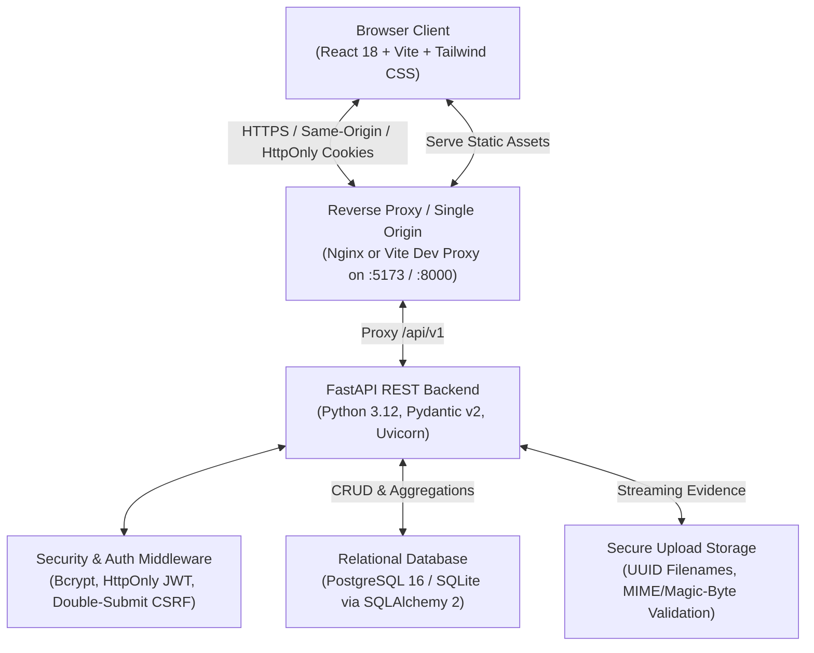

### Key Architectural Decisions
* **Same-Origin Proxying:** All `/api/v1` requests flow through the same origin as the frontend. This eliminates cross-origin tracking vectors and allows the use of secure `SameSite=Lax` or `Strict` cookies.
* **Stateless API with Stateful Sessions:** Sessions are represented by signed JWTs stored strictly inside **HttpOnly** cookies with a database-backed `token_version` check on every authenticated request for instant revocation on logout or account deactivation.
* **Zero LocalStorage Tokens:** No authentication tokens or sensitive student metrics are stored in `localStorage` or `sessionStorage`, completely neutralizing token theft via Cross-Site Scripting (XSS).

---

## 3. Technology Stack

| Layer | Technology | Version | Purpose |
|---|---|---|---|
| **Frontend Framework** | React | 18.3+ | Component-driven reactive user interface |
| **Language (Frontend)** | TypeScript | 5.5+ | Strict type safety and schema validation |
| **Build Tool** | Vite | 5.4+ | Lightning-fast HMR and optimized production bundles |
| **Styling** | Tailwind CSS | 3.4+ | Utility-first, responsive institutional design system |
| **State & Server Cache** | TanStack Query | 5.0+ | Optimistic caching, background refetching, and query synchronization |
| **Forms & Validation** | React Hook Form + Zod | 7.50+ / 3.23+ | Type-safe form parsing, client-side validation, and instant field errors |
| **Data Visualization** | Recharts | 2.13+ | Interactive skill radars, readiness gauges, and department bar charts |
| **Icons** | Lucide React | Latest | Clean, accessible iconography |
| **Backend Framework** | FastAPI | 0.115+ | High-performance asynchronous Python REST API |
| **Language (Backend)** | Python | 3.12+ | Strongly typed modern backend runtime |
| **Data Validation** | Pydantic | 2.10+ | Request/response DTO serialization and strict validation |
| **ORM & Database Engine**| SQLAlchemy + Alembic | 2.0+ / 1.14+ | Declarative DB mappings, migrations, and transactional safety |
| **Database Engines** | PostgreSQL 16 / SQLite | 16 / 3.x | Primary enterprise DB (production) / In-memory & dev DB (testing) |
| **Password Security** | Passlib + Bcrypt | 4.2+ | Adaptive work factor cryptographic password hashing |
| **Browser Automation** | Playwright | 1.48+ | Automated UI regression validation and visual screenshot capture |

---

## 4. Visual Feature Walkthrough with Screenshots

All screenshots below represent the live SkillTrack platform running against populated institutional data.

---

### 4.1 Public Landing Page
The landing page introduces prospective students and faculty to SkillTrack. It features institutional branding, high-level capability summaries (Skill Intelligence, Placement Readiness, Faculty Verification), and direct access to student registration and campus sign-in.

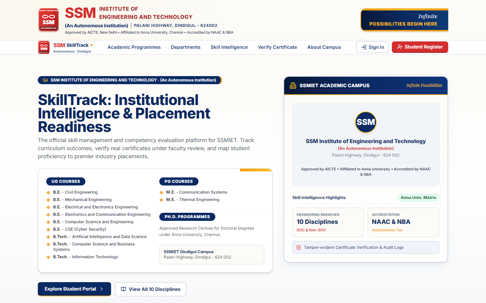

---

### 4.2 Authentication & Security
The authentication gateway provides a secure entry point for both Students and Administrators.
* **Role Separation:** Student registration is public; Administrator accounts can only be provisioned through secure CLI tools.
* **Security Controls:** Password strength enforcement (minimum 10 bytes with letter and digit constraints), bcrypt hashing, and instant invalidation of previous sessions.

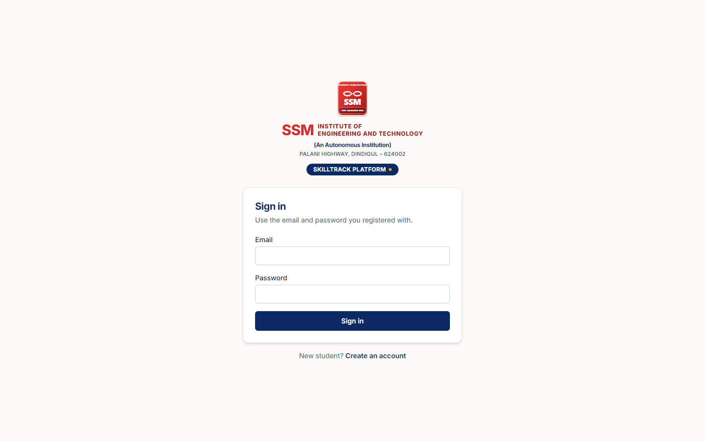

---

### 4.3 Student Dashboard
Upon signing in, students land on their central command center.
* **KPI Metrics:** Total self-reported skills, verified certificates count, portfolio projects, and current placement readiness index.
* **Profile Completion Meter:** Real-time 10-point checklist tracking profile completeness (avatar, bio, LinkedIn, GitHub, resume link, register number).
* **Recent Activity Feed:** Audit trail of recent student actions (certificate submissions, goal updates, and placement score additions).

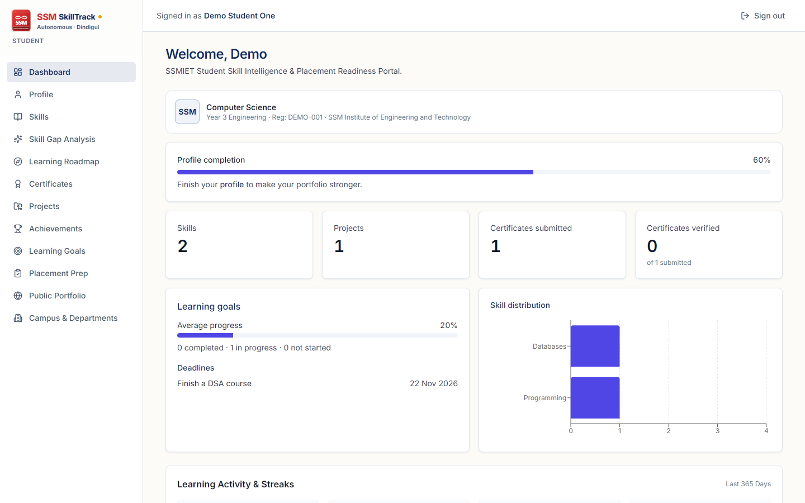

---

### 4.4 Skills Inventory Management
Students catalog technical and professional proficiencies categorized across **Programming**, **Frameworks**, **Databases**, **Tools**, and **Soft Skills**.
* **Proficiency Levels:** Beginner, Intermediate, Advanced, and Expert.
* **Search & Filters:** Real-time client-side search and category filtering.
* **Verification Status:** Visual badges indicating whether a skill is self-reported or backed by faculty-verified certification evidence.

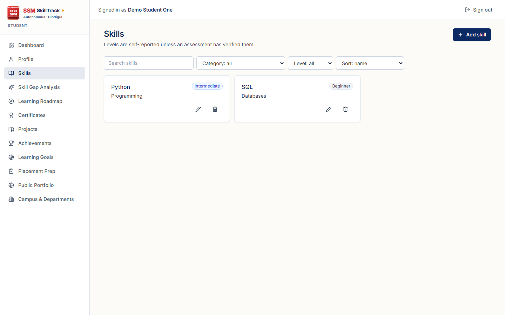

---

### 4.5 Skill Gap Analysis & Career Intelligence
An AI-informed career readiness engine that benchmarks a student's current skill profile against industry target roles (e.g., *Full Stack Developer*, *Data Scientist*, *Cloud & DevOps Engineer*, *Cybersecurity Specialist*).
* **Role Match Score:** Real-time percentage match calculated against required core competencies.
* **Gap Breakdown:** Clearly delineates **Acquired Skills** vs. **Missing / Recommended Skills** to prioritize learning efforts.

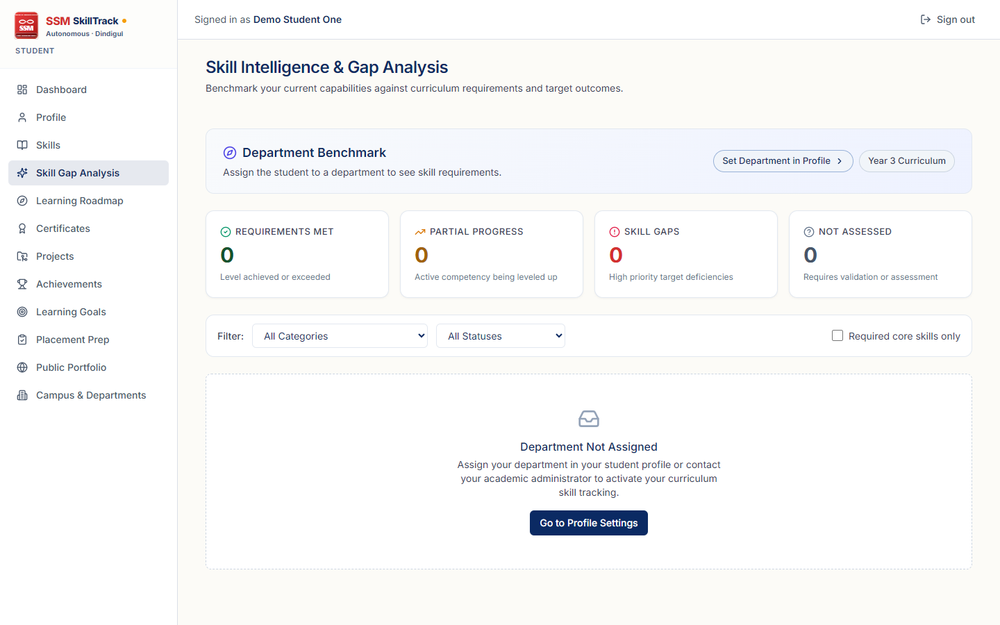

---

### 4.6 Interactive Learning Roadmap
A visual step-by-step career path roadmap guiding students from foundational computer science concepts to advanced specialized topics.
* **Phase Progression:** Phase 1 (Core Foundations) ➔ Phase 2 (Advanced Specialization) ➔ Phase 3 (Capstones & Production Readiness).
* **Direct Links:** Integrated curated resources, documentation links, and actionable milestones for each step.

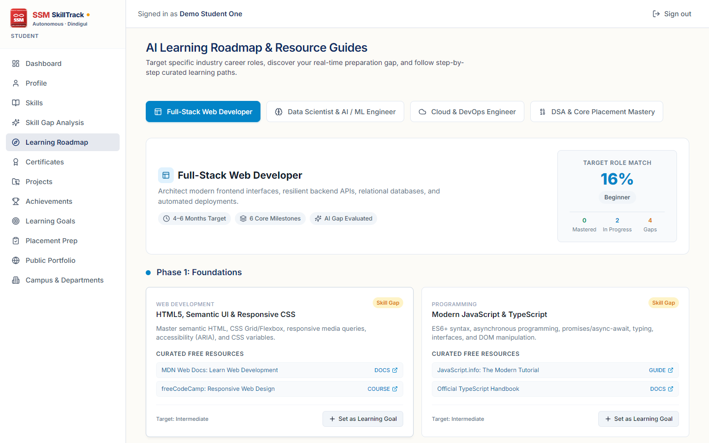

---

### 4.7 Certifications & Proof Verification
Students log professional credentials (AWS, Google Cloud, Cisco, Coursera, NPTEL) with issue dates, expiration dates, credential IDs, and official verification URLs.
* **Evidence Upload:** Upload PDF, PNG, or JPG proofs directly to secure private storage.
* **Status Lifecycle:** `Pending Review` ➔ `Verified` (by admin) or `Rejected` (with review notes).
* **Auto-Revert Security:** If a student alters any credential field after verification, its status automatically reverts to `Pending` to prevent tampering.

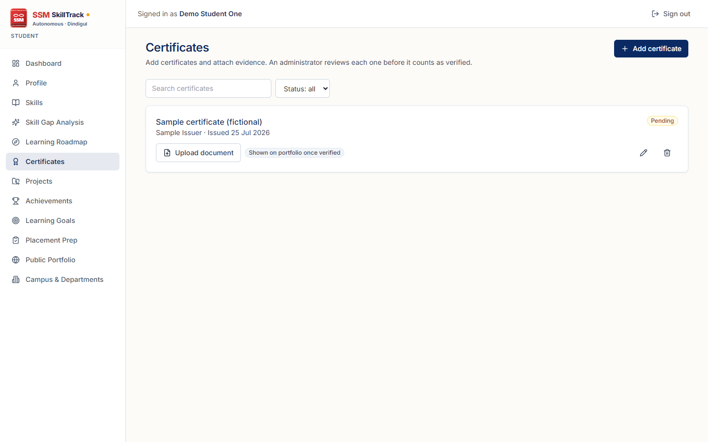

---

### 4.8 Projects Showcase & Highlights
A dedicated project management module where students highlight academic, capstone, and open-source software projects.
* **Metadata Fields:** Project title, rich description, primary tech stack tags, live deployment URL, and GitHub repository link.
* **Portfolio Display Order:** Drag-and-drop or position-based reordering for custom portfolio prioritization.

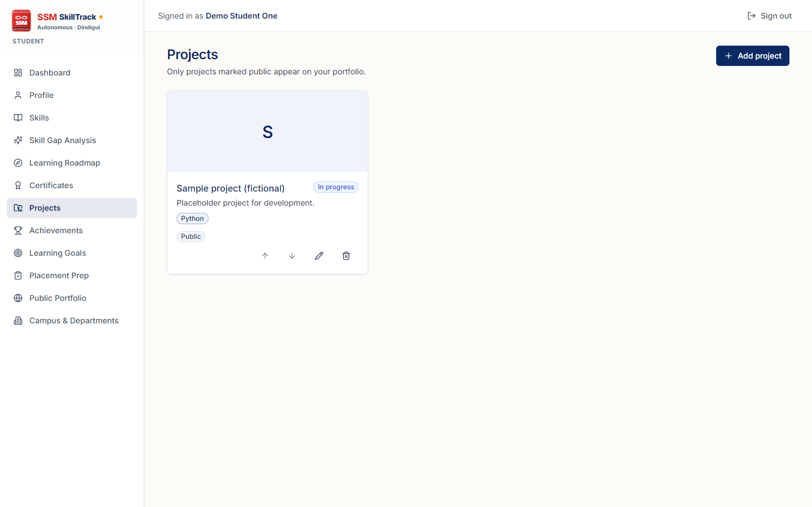

---

### 4.9 Achievements & Gamification Badges
Recognition engine celebrating student milestones in hackathons, coding contests, academic honors, and extra-curricular leadership.
* **Achievement Categories:** Hackathons, Competitions, Academic Honors, and Publications.
* **Milestone Badges:** Automatically unlocked badges for profile completion, verified certifications, and placement preparation streaks.

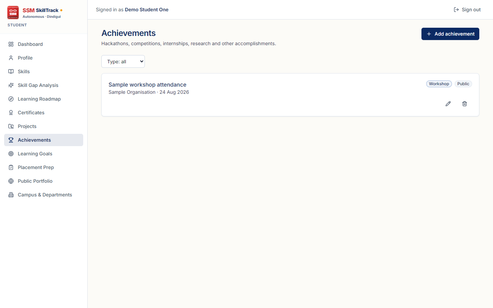

---

### 4.10 Learning Goals & Milestone Tracking
An interactive goal management framework encouraging structured skill acquisition.
* **Progress Slider:** Granular completion tracking (0% to 100%).
* **Overdue Detection:** Automatic alerts for goals exceeding their target completion date.
* **Automatic Status Synchronization:** Setting progress to 100% marks the goal completed; lowering progress below 100% reopens the goal to in-progress.

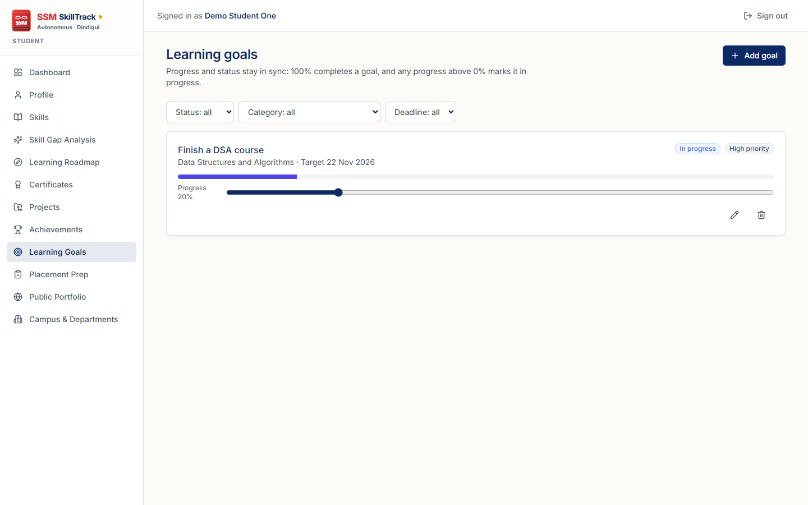

---

### 4.11 Placement Preparation & Readiness Analytics
Comprehensive mock assessment module tracking performance across key campus placement rounds:
* **Core Domains:** Quantitative Aptitude, Logical Reasoning, Technical Coding, and Mock Technical/HR Interviews.
* **Scoring Metrics:** Normalised percentage calculations over recent assessments.
* **Readiness Index:** Aggregate average across active categories, highlighting domain strengths and areas needing improvement.

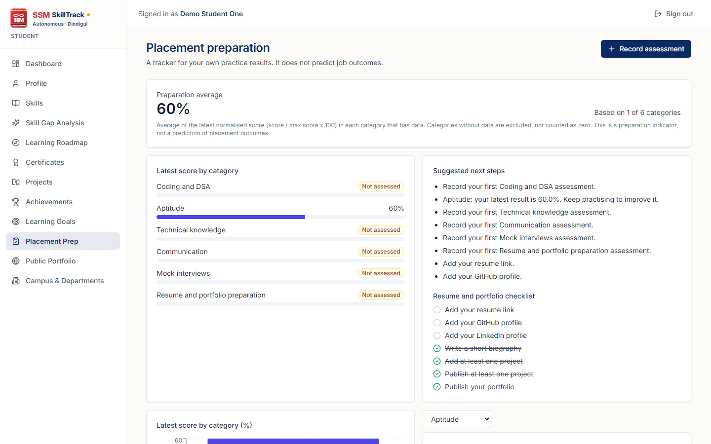

---

### 4.12 Public Student Portfolio
Each student can claim a unique handle (e.g., `/portfolio/demo-student-one`) to publish a public showcase.
* **Allow-list Serialization:** Zero leakage of confidential student records (emails, registration numbers, internal notes, and unverified certificates are strictly stripped by backend schemas).
* **Custom Visibility:** Students can toggle specific sections (Projects, Skills, Certifications, Achievements) on or off.

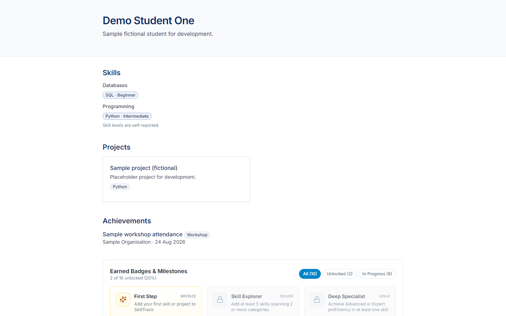

---

### 4.13 Administrator Institutional Overview
The executive dashboard for college principals, department heads, and placement officers.
* **Aggregated Metrics:** Total active students, total verified certificates, average placement readiness index across all departments.
* **Visual Analytics:** Distribution charts of student skills across departments and placement readiness histograms.

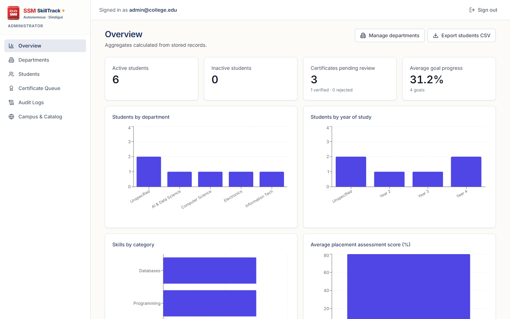

---

### 4.14 Administrator Certification Review Queue
Centralized verification workflow for college administrators to validate student certificates.
* **Actionable Table:** Lists pending certificates with student register number, issuer name, and issue date.
* **Evidence Inspection:** One-click preview of original evidence files served via authenticated streaming endpoints.
* **Review Controls:** Approve or Reject with optional feedback notes delivered directly to the student.

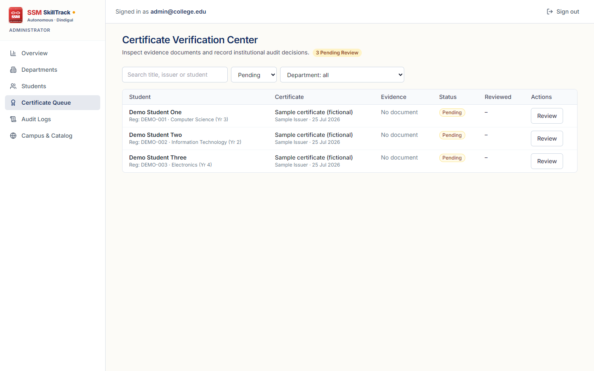

---

### 4.15 Administrator Student Directory & Account Management
Institutional directory of all registered students with filtering by Department, Year of Study, and Account Status.
* **Account Controls:** One-click activation or deactivation of student accounts (deactivation immediately terminates all active sessions).
* **Export Facility:** One-click formula-safe CSV export for university accreditation (NAAC/NBA).

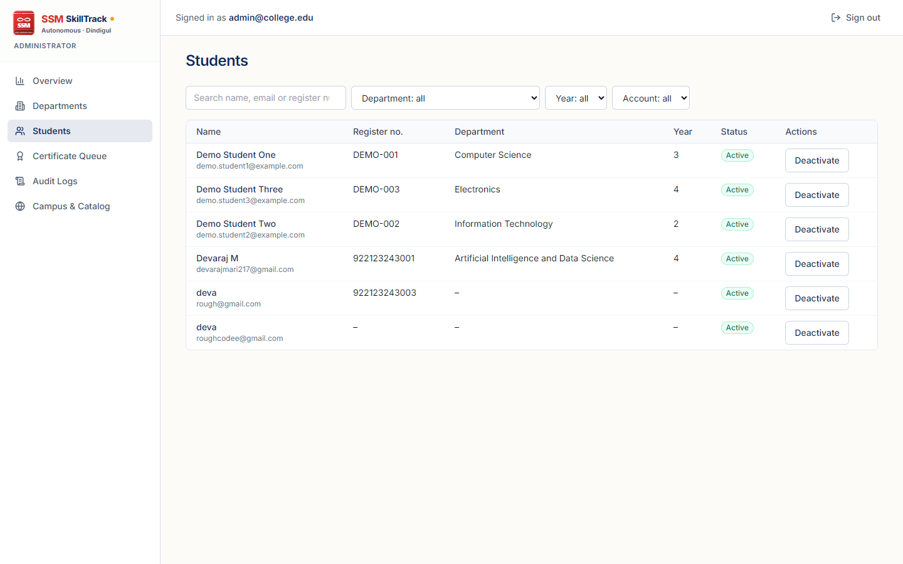

---

### 4.16 Administrator Department Directory
Departmental hierarchy and cohort analytics dividing the institution into School of Computing (SoC) and Non-SoC engineering branches.
* **Department Metrics:** Student enrollment numbers, average skills per student, and certificate verification rates by branch.

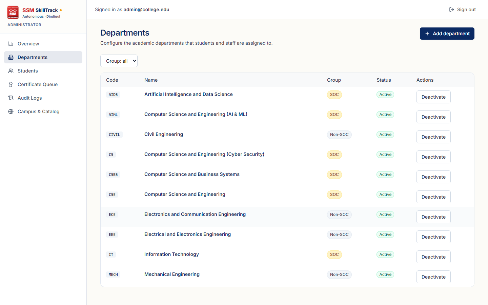

---

### 4.17 Administrator Audit Trail & Activity Logs
Comprehensive, immutable system audit log capturing administrative actions (verification approvals, student deactivations) and user milestone events for accountability and compliance.

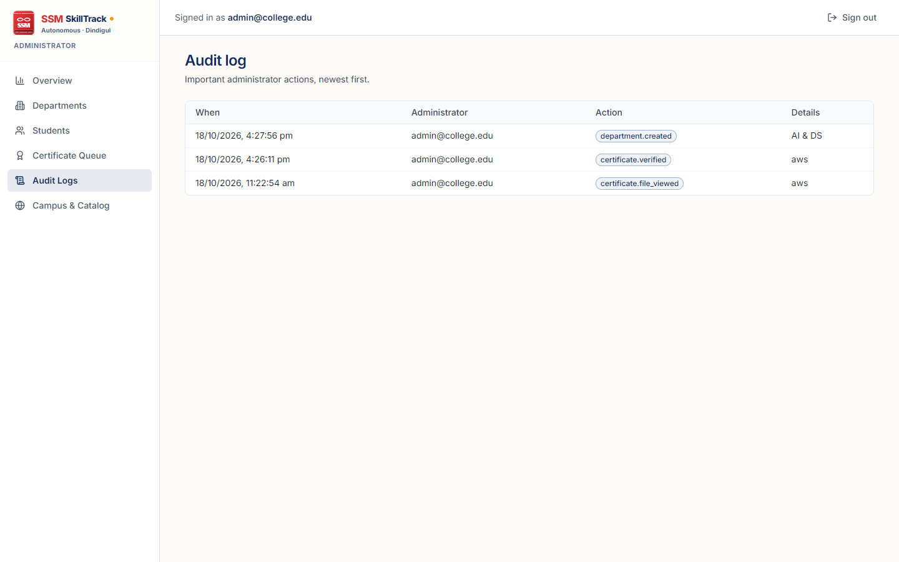

---

## 5. Database Schema & Entity Relationships

The relational architecture is designed for data integrity, strict constraints, and non-prospecting 404 access boundaries.

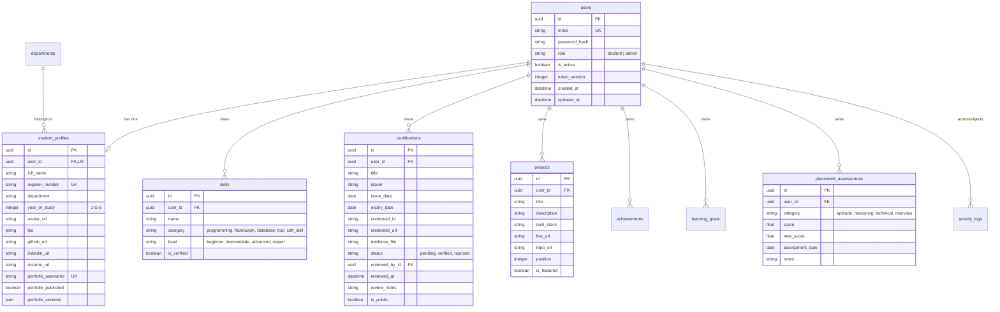

### Key Schema Constraints
1. **Ownership Cascade:** Every student table references `users.id` with `ON DELETE CASCADE`. Deleting a user cleanly purges all owned records without orphan anomalies.
2. **Reviewer Nullification:** `certifications.reviewed_by_id` references `users.id` with `ON DELETE SET NULL`. If an admin account is removed, verification records retain reviewer timestamps while preserving data integrity.
3. **Check Constraints:** 
   - `certifications.expiry_date >= certifications.issue_date`
   - `learning_goals.progress BETWEEN 0 AND 100`
   - `placement_assessments.score >= 0 AND placement_assessments.max_score > 0 AND placement_assessments.score <= placement_assessments.max_score`

---

## 6. Security & Access Control Architecture

| Threat Vector | Mitigation in SkillTrack |
|---|---|
| **Session Hijacking / XSS** | JWTs are stored exclusively in **HttpOnly, SameSite=Lax** cookies. JavaScript code cannot read or exfiltrate tokens. |
| **Cross-Site Request Forgery (CSRF)**| Double-submit cookie verification. Every state-changing request (`POST`, `PATCH`, `DELETE`) must send an `X-CSRF-Token` header matching the readable `csrf_token` cookie. |
| **ID Enumeration Probing** | Accessing another student's private record returns **404 Not Found**, never 403 Forbidden. Attackers cannot determine whether an entity ID exists. |
| **Token Invalidation Delay** | Every user record tracks an integer `token_version`. Logging out or disabling an account increments this version, instantly invalidating all extant JWTs across all browser instances. |
| **Malicious File Uploads** | Certificate evidence files are stored outside static web roots with server-generated UUID filenames. Uploads are strictly validated against allowed extensions (`.pdf`, `.png`, `.jpg`), declared MIME types, magic byte headers, and a strict 5 MB file size limit. |
| **Formula Injection (CSV Injection)**| Institutional student CSV exports sanitize every cell starting with `=`, `+`, `-`, or `@` by prefixing a single quote `'` to neutralize executable spreadsheet macros. |
| **PII Data Leakage on Portfolios** | Public portfolio payloads are processed through strict Pydantic allow-lists (`schemas/portfolio.py`). Private emails, internal review notes, register numbers, and unverified credentials cannot be serialized. |

---

## 7. API Reference Summary

The FastAPI backend exposes interactive OpenAPI / Swagger documentation at `http://localhost:8000/docs`. Base path: `/api/v1`.

| Module | Method & Endpoint | Access | Purpose |
|---|---|---|---|
| **Auth** | `POST /auth/register` | Public | Register new student account |
| **Auth** | `POST /auth/login` | Public | Sign in and set HttpOnly session cookies |
| **Auth** | `POST /auth/logout` | Authenticated | Revoke session and bump token version |
| **Auth** | `GET /auth/me` | Authenticated | Return authenticated profile & role |
| **Profile** | `GET /students/me` | Student | Retrieve own detailed profile |
| **Profile** | `PATCH /students/me` | Student | Update profile, bio, URLs, portfolio visibility |
| **Skills** | `GET /skills` | Student | List personal skills (supports search & filters) |
| **Skills** | `POST /skills` | Student | Add a new technical proficiency |
| **Skills** | `PATCH /skills/{id}` | Student | Update level or category |
| **Skills** | `DELETE /skills/{id}` | Student | Remove skill entry |
| **Certifications** | `GET /certifications` | Student | List personal credentials and review status |
| **Certifications** | `POST /certifications` | Student | Submit new certificate for verification |
| **Certifications** | `POST /certifications/{id}/file` | Student | Upload verification evidence document (PDF/Image) |
| **Certifications** | `GET /certifications/{id}/file` | Student/Admin | Stream authenticated certificate evidence file |
| **Projects** | `GET /projects` | Student | List showcase projects |
| **Projects** | `POST /projects` | Student | Create project card |
| **Projects** | `POST /projects/reorder` | Student | Update custom display order |
| **Goals** | `GET /goals` | Student | List learning goals with overdue flags |
| **Goals** | `POST /goals` | Student | Create new milestone goal |
| **Placement** | `GET /placement/assessments` | Student | List mock test scores |
| **Placement** | `GET /placement/summary` | Student | Compute readiness index and category breakdown |
| **Dashboard** | `GET /dashboard` | Student | Aggregated student overview metrics |
| **Public** | `GET /portfolio/{username}` | Public | Allow-list serialized public portfolio payload |
| **Admin** | `GET /admin/analytics` | Admin | Institutional aggregates, department distributions |
| **Admin** | `GET /admin/students` | Admin | Searchable student directory |
| **Admin** | `PATCH /admin/students/{id}/status` | Admin | Toggle account active/disabled |
| **Admin** | `GET /admin/certifications` | Admin | Queue of student certificates |
| **Admin** | `PATCH /admin/certifications/{id}/review` | Admin | Approve or reject credential with review notes |
| **Admin** | `GET /admin/reports/students.csv` | Admin | Formula-safe institutional CSV download |
| **Admin** | `GET /admin/activity-logs` | Admin | Immutable system audit log |
| **System** | `GET /health` | Public | Service health probe |

---

## 8. Installation & Local Setup Guide

### Prerequisites
* **Python:** 3.12 or newer
* **Node.js:** 20.x or 22.x
* **Database:** SQLite (built-in, zero-setup for dev) or PostgreSQL 14+ (recommended for production)

### Step 1: Clone and Configure Backend
```powershell
cd D:\student-skill-tracker\backend

# Create virtual environment
py -3.12 -m venv .venv
.\.venv\Scripts\Activate.ps1

# Install dependencies
pip install -r requirements.txt

# Configure environment
Copy-Item .env.example .env
```
Ensure `backend/.env` contains your database configuration:
```env
APP_ENV=development
DATABASE_URL=sqlite:///./skilltrack.db
SECRET_KEY=YourSuperSecretKeyWithAtLeast32CharactersHere!
ACCESS_TOKEN_MINUTES=60
CORS_ORIGINS=http://localhost:5173,http://localhost:5174
MAX_UPLOAD_BYTES=5242880
COOKIE_SAMESITE=lax
```

### Step 2: Run Database Migrations
```powershell
alembic upgrade head
```

### Step 3: Seed Sample Institutional Data (Optional for Dev)
```powershell
python -m app.cli seed-dev
```
*Creates sample students (`demo.student1@example.com` ... `demo.student3@example.com`) with password `DevPassword123`.*

### Step 4: Create Administrator Account
```powershell
python scripts/create_admin.py --email admin@college.edu
```
*(You will be prompted to securely type and confirm the admin password).*

### Step 5: Start Backend API
```powershell
uvicorn app.main:app --reload --port 8000
```
*API is accessible at `http://localhost:8000` with Swagger docs at `http://localhost:8000/docs`.*

### Step 6: Configure and Start Frontend (Second Terminal)
```powershell
cd D:\student-skill-tracker\frontend
npm install
npm run dev
```
*Application opens at `http://localhost:5173` with automatic `/api` reverse proxying to `:8000`.*

---

## 9. Automated Testing & Screenshot Pipeline

### Running Test Suites
```powershell
# Backend isolated unit & integration tests (runs on fast in-memory SQLite)
cd backend
python -m pytest -q

# Frontend React component and schema tests
cd ..\frontend
npm test
```

### Automated UI Screenshot Generation
The repository includes an automated headless browser pipeline using Playwright that starts the application, authenticates as both student and admin, navigates to every screen, and saves high-resolution (1440x900) screenshots directly into `docs/screenshots/`:
```powershell
python scripts/capture_all_screenshots.py
```

---

*Student Skill and Certification Management System (SkillTrack).*
